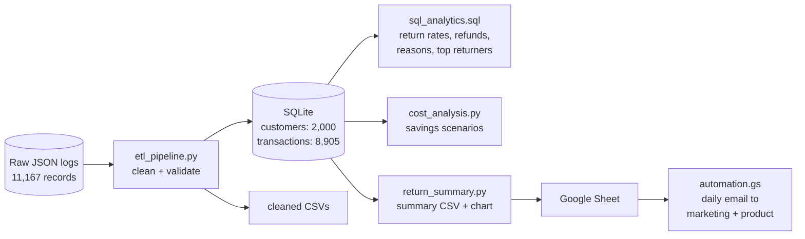

# E-Commerce Returns Analytics - Data Pipeline & Return Analysis

A data analytics project that finds where an online store is losing money to product returns. A Python pipeline cleans 11,000+ messy raw JSON records into a SQLite database. SQL queries break down return rates and refunds by category, and a Google Apps Script emails a daily summary to the marketing and product teams.

**Stack:** Python, Pandas, SQL, SQLite, Matplotlib, Google Apps Script

> The dataset is simulated. It's built to look like the event logs of an Indian e-commerce store, including the data quality problems real logs have.


## Problem Statement

Returns hurt an e-commerce business twice. The refund wipes out the sale, and the store also pays for return shipping, inspection and restocking.

The store's overall return rate is about 11%, which looks fine. The goal was to find out:

1. whether that average hides a problem in a specific category
2. what is causing it
3. how much fixing it would be worth

Before any of that, the raw data had to be cleaned, because the logs couldn't be analysed as they were.

## What I Did

1. **Cleaned the raw data.** I fixed duplicates, test accounts, inconsistent labels, mixed date formats, amounts stored as text, and blank values (details below).
2. **Loaded it into SQLite** as two tables: `customers` and `transactions`.
3. **Analysed it with SQL**: return rate by category, refund totals, return reasons and top returners.
4. **Estimated the savings** from bringing Apparel returns down.
5. **Automated the reporting** with a daily email that flags any category with a high return rate.

## Data Cleaning

The raw files have 11,167 records: 2,030 customer records and 9,137 events. Running `python etl_pipeline.py` fixes them step by step and prints what it changed:

| Problem in the raw data | Example | Fix | Rows |
|---|---|---|---|
| Duplicate customers | same `_id` twice | keep one | 25 |
| Test accounts | `TEST001`, status `test` | remove | 5 |
| Missing city | `null` or `""` | set to `Unknown` | 25 |
| Inconsistent city names | `" mumbai"`, `PUNE`, `Bengaluru` | trim, title case, `Bengaluru` -> `Bangalore` | |
| Duplicate events | same `event_id` logged twice | keep one | 180 |
| Events from test accounts | `user_id = TEST003` | remove | 40 |
| Incomplete events | no product category | remove | 12 |
| Inconsistent labels | `apparel `, `APPAREL`, `SIZE_ISSUE` | trim and title case | |
| Amounts stored as text | `"Rs. 4,284.59"` | strip `Rs.` and commas, convert to number | 541 |
| Negative refunds | `-2621.63` | take the absolute value | 57 |
| Three date formats | `2024-05-13`, `2024-05-13T00:00:00`, `13/05/2024` | parse each format | |
| Blank payment method | `null` or `""` on a purchase | set to `Unknown` | 261 |

After cleaning: **2,000 customers and 8,905 transactions** (8,000 purchases and 905 returns).

## Key Findings

| Category | Purchases | Returns | Return Rate | Total Refunds | Share of Refunds | Return Reasons |
|---|---|---|---|---|---|---|
| **Apparel** | 1,898 | 601 | **31.7%** | **Rs. 16.63 L** | **66.7%** | 100% Size Issue |
| Electronics | 2,053 | 105 | 5.1% | Rs. 2.84 L | 11.4% | Defective 53%, Changed Mind 47% |
| Home | 1,989 | 100 | 5.0% | Rs. 2.85 L | 11.4% | Defective 52%, Changed Mind 48% |
| Beauty | 2,060 | 99 | 4.8% | Rs. 2.63 L | 10.5% | Changed Mind 52%, Defective 48% |
| **Total** | **8,000** | **905** | **11.3%** | **Rs. 24.94 L** | 100% | |

1. **Apparel returns at 31.7%**, more than 6x the ~5% seen in every other category.
2. **Apparel causes 66% of all returns** (601 of 905) and **Rs. 16.6 lakh of the Rs. 24.9 lakh** in total refunds.
3. **Every Apparel return is a "Size Issue".** The other categories have a normal mix of defects and changed minds. So the problem isn't product quality. Customers can't tell which size to buy.

**Recommendation:** fix the Apparel size guides first (clear measurements, fit notes, a size recommender), and have marketing review paid ads on high-return Apparel products until the return rate comes down.

## What Fixing Sizing Is Worth

`cost_analysis.py` estimates the savings if the Apparel return rate drops. It counts both the refund and an assumed Rs. 200 reverse-logistics cost per return:

| Apparel return rate | Returns | Refunds + handling | Savings |
|---|---|---|---|
| 31.7% (today) | 601 | Rs. 17.84 L | - |
| 20% | 379 | Rs. 11.25 L | Rs. 6.6 L |
| 10% | 189 | Rs. 5.61 L | Rs. 12.2 L |
| 5% (other categories) | 94 | Rs. 2.79 L | Rs. 15.0 L |

## Architecture



## How It Works

**1. ETL (`etl_pipeline.py`).** The raw logs are nested JSON. A customer's city and signup date sit inside a `profile` object, and each event keeps its details inside a `payload` object. The pipeline flattens both with `pd.json_normalize` and then runs the cleaning steps in the table above. Each step prints how many rows it changed. The result is saved to SQLite and to CSV.

**2. SQL analysis (`sql_analytics.sql`).** Four queries:
- return rate by category, counting purchases and returns with `SUM(CASE WHEN ...)`
- refund totals and each category's share of all refunds
- return reasons in each category, which is where the size issue shows up
- the top 10 customers by items returned

**3. Savings (`cost_analysis.py`).** Works out the savings scenarios above.

**4. Automated reporting.** `return_summary.py` writes `return_summary.csv` and the return-rate chart. The CSV is imported into a Google Sheet. `automation.gs` reads that sheet every morning at 9 AM and emails the table to the marketing and product teams. Any category with a return rate above 15% is highlighted and named in the subject line.

## Database Schema

**customers** (2,000 rows)

| Column | Type | Description |
|---|---|---|
| `customer_id` | TEXT | `U00001` to `U02000` |
| `location` | TEXT | Mumbai, Delhi, Bangalore, Hyderabad, Pune, or Unknown |
| `signup_date` | DATETIME | Registration date |
| `status` | TEXT | Account status |

**transactions** (8,905 rows)

| Column | Type | Description |
|---|---|---|
| `transaction_id` | TEXT | `EV000001` to `EV008905` |
| `event_type` | TEXT | `purchase` or `return` |
| `timestamp` | DATETIME | Event date |
| `customer_id` | TEXT | Links to `customers` |
| `product_category` | TEXT | Apparel, Electronics, Home, Beauty |
| `amount` | REAL | Purchase amount in INR (0 for returns) |
| `payment_method` | TEXT | UPI, Credit Card, Debit Card, Unknown (N/A for returns) |
| `refund_amount` | REAL | Refund in INR (0 for purchases) |
| `reason` | TEXT | Size Issue, Defective, Changed Mind (No Return for purchases) |

## Project Structure

```
├── raw_data/
│   ├── raw_users.json        # 2,030 raw customer records
│   └── raw_events.json       # 9,137 raw purchase and return events
├── images/
│   └── return_rate_by_category.png
├── etl_pipeline.py           # cleaning + load into SQLite
├── sql_analytics.sql         # analysis queries
├── cost_analysis.py          # savings scenarios
├── return_summary.py         # summary CSV for the Google Sheet + chart
├── automation.gs             # daily email (Google Apps Script)
├── business_report.md        # findings written up for the business teams
└── requirements.txt
```

## Running It

```bash
git clone https://github.com/Saksham2410del/Ecommerce-returns-analytics.git
cd Ecommerce-returns-analytics
pip install -r requirements.txt

python etl_pipeline.py        # cleans the data, builds ecommerce_data_warehouse.db
python return_summary.py      # summary CSV + chart
python cost_analysis.py       # savings scenarios
```

To run the SQL queries, open `ecommerce_data_warehouse.db` in [DB Browser for SQLite](https://sqlitebrowser.org/) and paste them in, or use the command line:

```bash
sqlite3 ecommerce_data_warehouse.db < sql_analytics.sql
```

For the email: import `return_summary.csv` into a Google Sheet tab named `Return Analytics`, paste `automation.gs` into Extensions > Apps Script, and run `setupDailyTrigger()` once.

## Limitations

- The data is simulated, so the patterns are cleaner than real data would be. For example, it's unusual for 100% of a category's returns to share one reason.
- Returns aren't linked to a specific order ID, so return rates are calculated per category (returns ÷ purchases), not per order.
- There's no ad spend data, so the marketing recommendation is to review ads on high-return products, not a measured ROI figure.
