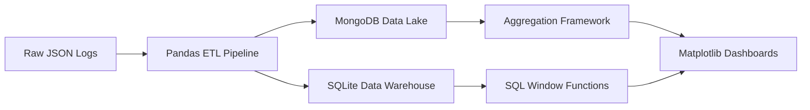

# E-Commerce Returns Analytics Platform

A complete end-to-end Data Analytics pipeline for processing e-commerce transaction logs and identifying profitability leaks. This project handles everything from raw JSON data ingestion to NoSQL aggregation, relational window functions, and automated business reporting.

## Project Architecture



## Key Technologies

* **Data Engineering**: Python, Pandas, JSON
* **Databases**: MongoDB (NoSQL), SQLite (Relational)
* **Data Analytics**: Advanced MongoDB Aggregations, SQL Window Functions (CTEs)
* **Data Visualization**: Matplotlib, Jupyter Notebooks
* **Automation**: Google Apps Script

## Overview

The goal of this project is to build a robust data pipeline to identify the root cause of profit erosion in an e-commerce platform. Processing thousands of simulated, unstructured event logs, the pipeline uncovers that the 'Apparel' category is suffering from a massive 35% return rate due to sizing issues. It employs a modern data stack approach, migrating data from a NoSQL Data Lake into a highly structured Relational Data Warehouse for cross-functional business intelligence reporting.

## Core Features

1. **Automated ETL Pipeline**: Ingests raw, nested JSON event logs. The Python script handles missing values, normalizes nested dictionaries, and converts standardizes timestamps to prepare the data for downstream analytics.
2. **Dual-Database Architecture**: Simulates an enterprise architecture by loading unstructured data into a MongoDB Data Lake while simultaneously pushing structured data into an SQLite Data Warehouse.
3. **Advanced NoSQL Queries**: Utilizes the MongoDB Aggregation Framework (`$match`, `$group`, `$unwind`, `$addFields`) to dynamically calculate return rates directly within the database engine.
4. **Relational Data Warehouse**: Employs advanced standard SQL queries, including Common Table Expressions (CTEs) and Window Functions (e.g., `RANK() OVER (PARTITION BY...)`), to rank serial returners and analyze performance.
5. **Business Intelligence Visualization**: Leverages Matplotlib within a Jupyter environment to generate stakeholder-ready dashboards that highlight failing product lines.
6. **Workflow Automation**: Integrates a Google Apps Script to automate the distribution of analytical findings to Marketing and Product teams.

## Local Development Setup

To run this project locally on your machine:

```bash
# 1. Clone the repository
git clone https://github.com/YOUR-USERNAME/ecommerce-returns-analytics.git
cd ecommerce-returns-analytics

# 2. Set up the virtual environment (optional but recommended)
python -m venv .venv
source .venv/bin/activate  # On Windows use: .venv\Scripts\activate

# 3. Install dependencies
pip install -r requirements.txt

# 4. Run the ETL Pipeline
python etl_pipeline.py
```

You can now open `data_analysis.ipynb` in VS Code or Jupyter and run all cells to view the analytical dashboards.

## License

MIT License. See `LICENSE` for details.
