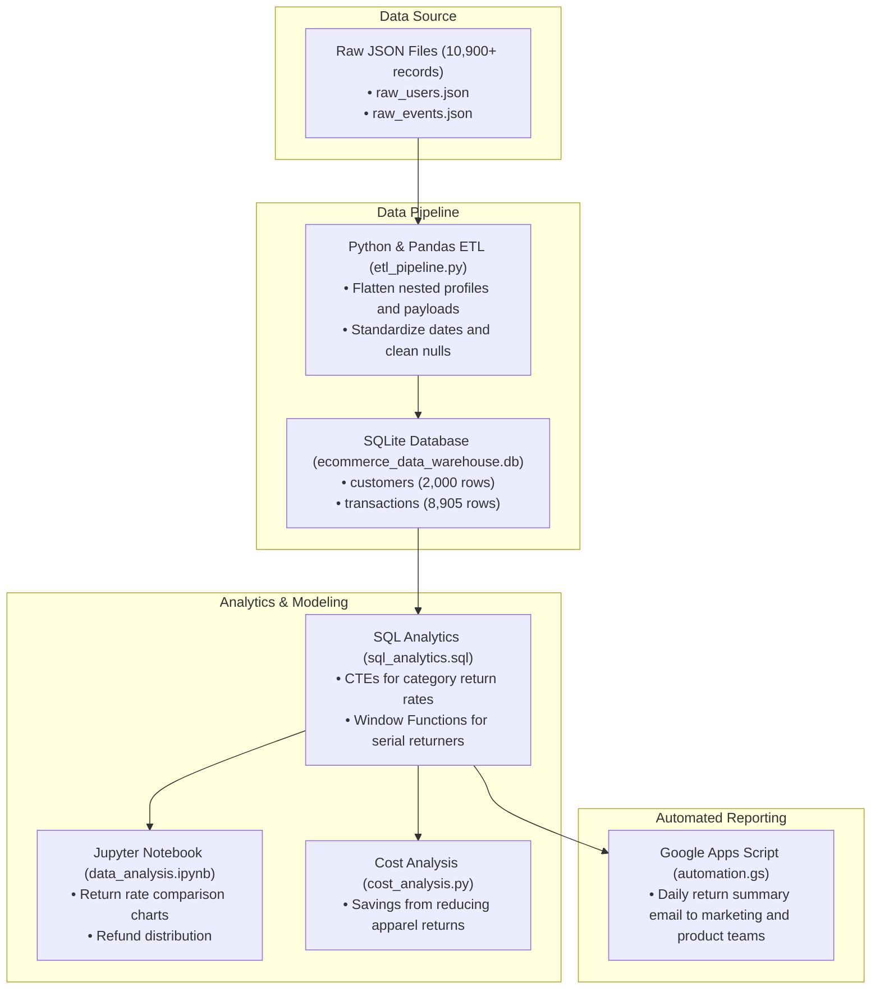

# E-Commerce Returns Analytics: Data Pipeline & Cost Analysis (Simulated Dataset)

A data analytics project that identifies and diagnoses profit leaks caused by high product return rates. Processing a simulated dataset of 10,900+ raw JSON transaction logs into a SQLite database, it runs SQL queries to uncover return patterns across categories, models financial savings from reducing size-related returns, and automates reporting to marketing and product teams.

---

## Problem Statement

In e-commerce, product returns directly hurt profitability. Beyond the lost order value, every return incurs reverse logistics expenses (return shipping labels, inspection, warehouse restocking) and leads to inventory depreciation.

Across our simulated platform dataset of 2,000 customers and 8,000+ orders, the overall platform return rate appeared manageable at ~11%. However, an aggregate view concealed a major profit leak:

1. **Category Discrepancy:** While Electronics, Home, and Beauty maintained a healthy baseline return rate of ~5%, **Apparel suffered an abnormal return rate of 31.7%**.
2. **Financial Drain:** Apparel alone accounted for **66% of all returned items** and was responsible for **Rs. 16.6 Lakh out of Rs. 24.9 Lakh in total refunds**.
3. **Root Cause:** Analysis of return reasons showed that **100% of Apparel returns were caused by "Size Issues"**, whereas other categories returned items due to defects or changed minds.
4. **Marketing Inefficiency:** Marketing was actively spending ad budget acquiring customers for Apparel items that had a near one-in-three chance of being returned, resulting in negative Return on Ad Spend (ROAS).

**Objective:** Build an automated data pipeline to clean and store transaction logs, run SQL analytics to quantify category return rates and rank serial returners, model financial savings from improving sizing guides, and automate alerts so marketing can immediately pause ad spend on high-return products.

---

## Project Architecture



---

## Database Schema

The cleaned data is stored in a SQLite relational database (`ecommerce_data_warehouse.db`) across two tables:

### 1. `customers` Table (2,000 records)
| Column | Type | Description |
| :--- | :--- | :--- |
| `customer_id` | TEXT (PK) | Unique customer identifier (`U00001` - `U02000`) |
| `location` | TEXT | Customer city (Mumbai, Delhi, Bangalore, Hyderabad, Pune) |
| `signup_date` | DATETIME | Customer registration timestamp |
| `status` | TEXT | Account status (`active`) |

### 2. `transactions` Table (8,905 records)
| Column | Type | Description |
| :--- | :--- | :--- |
| `transaction_id` | TEXT (PK) | Unique transaction ID (`EV000001` - `EV008905`) |
| `event_type` | TEXT | Event type (`purchase` or `return`) |
| `timestamp` | DATETIME | Transaction timestamp |
| `customer_id` | TEXT (FK) | References `customers.customer_id` |
| `product_category` | TEXT | Apparel, Electronics, Home, Beauty |
| `amount` | REAL | Purchase amount in INR |
| `payment_method` | TEXT | UPI, Credit Card, Debit Card |
| `refund_amount` | REAL | Refund amount issued (for return events) |
| `reason` | TEXT | Return reason (Size Issue, Changed Mind, Defective) |

---

## Key Findings & SQL Analysis

### Category Return Rates & Refund Breakdown
```sql
WITH category_purchases AS (
    SELECT product_category, COUNT(*) AS total_purchases
    FROM transactions WHERE event_type = 'purchase' GROUP BY product_category
),
category_returns AS (
    SELECT product_category, COUNT(*) AS total_returns
    FROM transactions WHERE event_type = 'return' GROUP BY product_category
)
SELECT 
    p.product_category,
    p.total_purchases,
    COALESCE(r.total_returns, 0) AS total_returns,
    ROUND(CAST(COALESCE(r.total_returns, 0) AS FLOAT) / p.total_purchases * 100, 2) AS return_rate_pct
FROM category_purchases p
LEFT JOIN category_returns r ON p.product_category = r.product_category
ORDER BY return_rate_pct DESC;
```

**Results:**
| Product Category | Purchases | Returns | Return Rate | Total Refunds (INR) | Share of All Refunds | Return Reasons |
| :--- | :--- | :--- | :--- | :--- | :--- | :--- |
| **Apparel** | 1,898 | 601 | **31.7%** | **Rs. 16.63 Lakh** | **66.7%** | **100% Size Issue** |
| **Electronics** | 2,053 | 105 | 5.1% | Rs. 2.84 Lakh | 11.4% | Defective (53%), Changed Mind (47%) |
| **Home** | 1,989 | 100 | 5.0% | Rs. 2.85 Lakh | 11.4% | Defective (52%), Changed Mind (48%) |
| **Beauty** | 2,060 | 99 | 4.8% | Rs. 2.63 Lakh | 10.5% | Changed Mind (52%), Defective (48%) |
| **Total / Avg** | **8,000** | **905** | **11.3%** | **Rs. 24.94 Lakh** | **100.0%** | — |

---

## Cost Savings Analysis

To evaluate the financial return of fixing sizing issues (e.g., introducing updated size charts, fit guides, and size recommendation tools), we modeled projected savings across the dataset, factoring in both refund amounts and an estimated Rs. 200 reverse logistics cost per returned unit:

* **Current Baseline (31.7% return rate):** Rs. 16.63 Lakh refunds + Rs. 1.20 Lakh shipping = **Rs. 17.84 Lakh total loss**.
* **Target 1 (Drop to 20%):** Reduces returns to 379 units $\rightarrow$ **modeled savings of Rs. 6.6 Lakhs**.
* **Target 2 (Drop to 10%):** Reduces returns to 189 units $\rightarrow$ **modeled savings of Rs. 12.2 Lakhs**.
* **Target 3 (Drop to 5% baseline):** Reduces returns to 94 units $\rightarrow$ **modeled savings of up to Rs. 15.0 Lakhs across the dataset**.

---

## Automated Reporting & Alerting

**Google Apps Script (`automation.gs`):** Connects to the return analytics spreadsheet and sends automated email alerts directly to the Marketing and Product teams (`marketing@ecommerce.com` and `product@ecommerce.com`) with current return rates, advising marketing to pause ad spend on high-return Apparel SKUs. Running `setupDailyTrigger()` once in the Google Apps Script editor installs the daily 9:00 AM schedule trigger.

---

## Tech Stack

* **Language:** Python
* **Data Processing & Visualization:** Pandas, Matplotlib
* **Database & Querying:** SQLite, SQL (Common Table Expressions, Window Functions)
* **Interactive Analysis:** Jupyter Notebook
* **Automation:** Google Apps Script

---

## Repository Structure

```text
├── raw_data/
│   ├── raw_users.json              # 2,000 raw customer records
│   └── raw_events.json             # 8,905 raw order & return events
├── etl_pipeline.py                 # Ingestion & cleaning script into SQLite
├── sql_analytics.sql               # SQL queries for return rates, refunds & serial returners
├── cost_analysis.py                # Cost savings calculations
├── data_analysis.ipynb             # Jupyter Notebook with charts and analysis
├── automation.gs                   # Google Apps Script for automated email alerts
├── business_report.md              # Detailed strategy and recommendation report
├── requirements.txt                # Python dependencies
├── .gitignore                      # Git ignore rules
└── README.md                       # Project documentation
```

---

## Setup & Execution

### 1. Set Up Environment
```bash
# Clone the repository
git clone https://github.com/Saksham2410del/Ecommerce-returns-analytics.git
cd Ecommerce-returns-analytics

# Create and activate virtual environment
python -m venv .venv
# On Windows:
.venv\Scripts\activate

# Install dependencies
pip install -r requirements.txt
```

### 2. Run the ETL Pipeline
Extracts raw JSON files, cleans nested payloads, and loads the SQLite database:
```bash
python etl_pipeline.py
```

### 3. Run Cost Analysis
Calculates projected savings across return reduction targets:
```bash
python cost_analysis.py
```

### 4. Launch Jupyter Notebook
```bash
jupyter notebook data_analysis.ipynb
```
