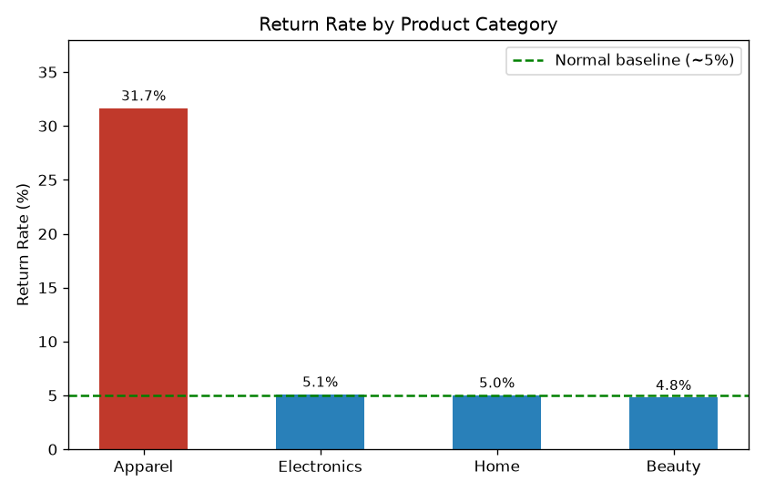
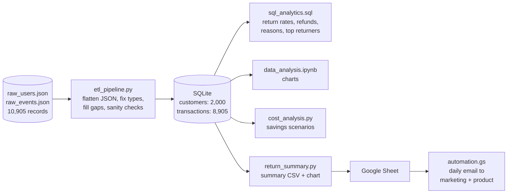

# E-Commerce Returns Analytics - Data Pipeline & Return Analysis

A data analytics project that finds where an online store is losing money to product returns. A Python pipeline cleans 10,900+ raw JSON records into a SQLite database, SQL queries break down return rates and refunds by category, and a Google Apps Script emails a daily summary to the marketing and product teams.

**Stack:** Python, Pandas, SQL, SQLite, Matplotlib, Jupyter, Google Apps Script

> The dataset is simulated, built to look like the event logs of an Indian e-commerce store.



## Problem Statement

Returns hurt an e-commerce business twice. The refund wipes out the sale, and the store also pays for return shipping, inspection and restocking.

In this store's data the overall return rate is about 11%, which looks fine at first. The question was whether that average was hiding a problem in a specific category, and if so, what was causing it and what fixing it would be worth.

## Key Findings

| Category | Purchases | Returns | Return Rate | Total Refunds | Share of Refunds | Return Reasons |
|---|---|---|---|---|---|---|
| **Apparel** | 1,898 | 601 | **31.7%** | **Rs. 16.63 L** | **66.7%** | 100% Size Issue |
| Electronics | 2,053 | 105 | 5.1% | Rs. 2.84 L | 11.4% | Defective 53%, Changed Mind 47% |
| Home | 1,989 | 100 | 5.0% | Rs. 2.85 L | 11.4% | Defective 52%, Changed Mind 48% |
| Beauty | 2,060 | 99 | 4.8% | Rs. 2.63 L | 10.5% | Changed Mind 52%, Defective 48% |
| **Total** | **8,000** | **905** | **11.3%** | **Rs. 24.94 L** | 100% | |

1. **Apparel returns at 31.7%**, more than 6x the ~5% seen in every other category.
2. **Apparel causes 66% of all returns** (601 of 905) and **Rs. 16.6 lakh of the Rs. 24.9 lakh** in total refunds.
3. **Every Apparel return is a "Size Issue".** The other categories have a normal mix of defects and changed minds. So the problem isn't product quality. Customers can't tell which size to buy.

**Recommendation:** fix the Apparel size guides first (clear measurements, fit notes, a size recommender), and have marketing review paid ads on high-return Apparel products until the return rate comes down.

## What Fixing Sizing Is Worth

`cost_analysis.py` estimates the savings if the Apparel return rate drops, counting both the refund and an assumed Rs. 200 reverse-logistics cost per return:

| Apparel return rate | Returns | Refunds + handling | Savings |
|---|---|---|---|
| 31.7% (today) | 601 | Rs. 17.84 L | - |
| 20% | 379 | Rs. 11.25 L | Rs. 6.6 L |
| 10% | 189 | Rs. 5.61 L | Rs. 12.2 L |
| 5% (other categories) | 94 | Rs. 2.79 L | Rs. 15.0 L |

## Architecture



## How It Works

**1. ETL (`etl_pipeline.py`).** The raw logs are nested JSON. A customer's location and signup date sit inside a `profile` object, and each event keeps its details inside a `payload` object. The payload has different keys for purchases (`amount`, `payment_method`) and returns (`refund_amount`, `reason`). The pipeline:
- flattens both files with `pd.json_normalize`
- renames columns and converts timestamps to datetimes
- removes duplicate IDs
- fills the fields that don't apply to an event type (for example, a purchase has no refund)
- checks for transactions with unknown customers and for negative amounts

It then loads two tables into SQLite.

**2. SQL analysis (`sql_analytics.sql`).** Four queries:
- return rate by category, counting purchases and returns with `SUM(CASE WHEN ...)`
- refund totals and each category's share of all refunds
- return reasons in each category, which is where the size issue shows up
- the top 10 customers by items returned

**3. Charts and savings.** The notebook (`data_analysis.ipynb`) runs the queries and plots the return-rate chart. `cost_analysis.py` models the savings scenarios above.

**4. Automated reporting.** `return_summary.py` writes `return_summary.csv`, which is imported into a Google Sheet. `automation.gs` reads that sheet every morning at 9 AM and emails the table to the marketing and product teams. Any category with a return rate above 15% is highlighted and named in the subject line. The numbers come from the sheet, so the email is always current.

## Database Schema

**customers** (2,000 rows)

| Column | Type | Description |
|---|---|---|
| `customer_id` | TEXT | `U00001` to `U02000` |
| `location` | TEXT | Mumbai, Delhi, Bangalore, Hyderabad, Pune |
| `signup_date` | DATETIME | Registration date |
| `status` | TEXT | Account status |

**transactions** (8,905 rows: 8,000 purchases, 905 returns)

| Column | Type | Description |
|---|---|---|
| `transaction_id` | TEXT | `EV000001` to `EV008905` |
| `event_type` | TEXT | `purchase` or `return` |
| `timestamp` | DATETIME | Event date |
| `customer_id` | TEXT | Links to `customers` |
| `product_category` | TEXT | Apparel, Electronics, Home, Beauty |
| `amount` | REAL | Purchase amount in INR (0 for returns) |
| `payment_method` | TEXT | UPI, Credit Card, Debit Card |
| `refund_amount` | REAL | Refund in INR (0 for purchases) |
| `reason` | TEXT | Size Issue, Defective, Changed Mind |

## Project Structure

```
├── raw_data/
│   ├── raw_users.json        # 2,000 customer records
│   └── raw_events.json       # 8,905 purchase and return events
├── images/
│   └── return_rate_by_category.png
├── etl_pipeline.py           # JSON -> cleaned tables -> SQLite
├── sql_analytics.sql         # return rate, refund, reason and top returner queries
├── data_analysis.ipynb       # analysis notebook with charts
├── cost_analysis.py          # savings scenarios
├── return_summary.py         # summary CSV for the Google Sheet + chart
├── automation.gs             # daily email (Google Apps Script)
├── business_report.md        # findings written up for the business teams
└── requirements.txt
```

## Running It

```bash
git clone https://github.com/Saksham2410del/Ecommerce-returns-analytics.git
cd Ecommerce-returns-analytics
pip install -r requirements.txt

python etl_pipeline.py        # builds ecommerce_data_warehouse.db
python return_summary.py      # summary CSV + chart
python cost_analysis.py       # savings scenarios
jupyter notebook data_analysis.ipynb
```

To run the SQL queries directly:

```bash
sqlite3 ecommerce_data_warehouse.db < sql_analytics.sql
```

For the email: import `return_summary.csv` into a Google Sheet tab named `Return Analytics`, paste `automation.gs` into Extensions > Apps Script, and run `setupDailyTrigger()` once.

## Limitations

- The data is simulated, so the patterns are cleaner than real data would be. For example, it's unusual for 100% of a category's returns to share one reason.
- Returns aren't linked to a specific order ID, so return rates are calculated per category (returns ÷ purchases), not per order.
- There's no ad spend data, so the marketing recommendation is to review ads on high-return products, not a measured ROI figure.
